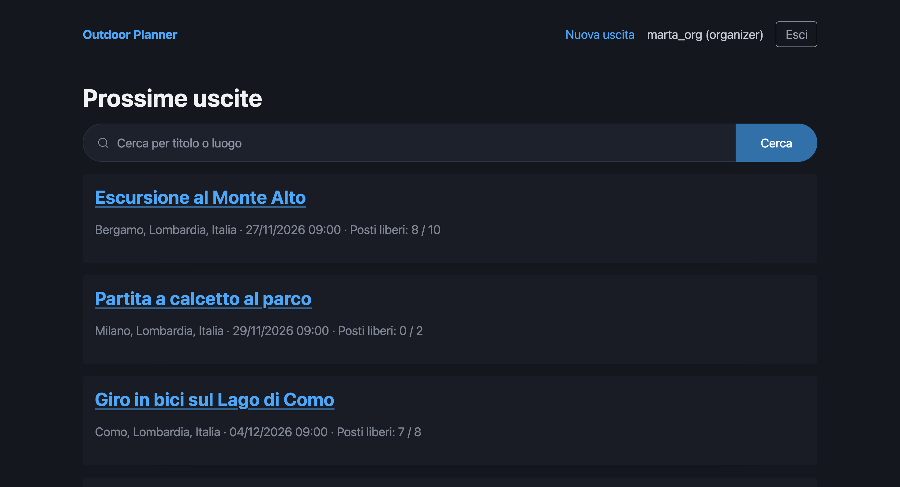
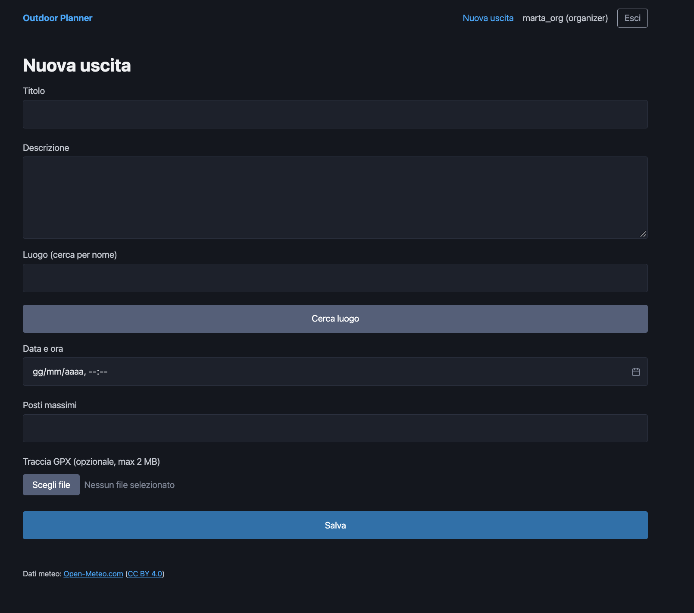
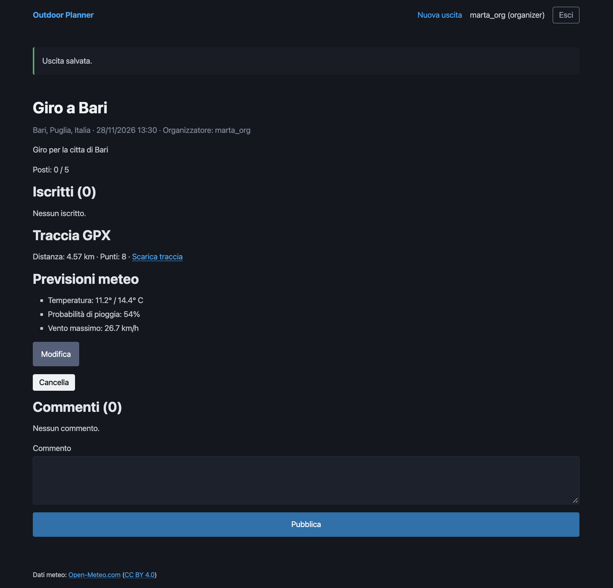
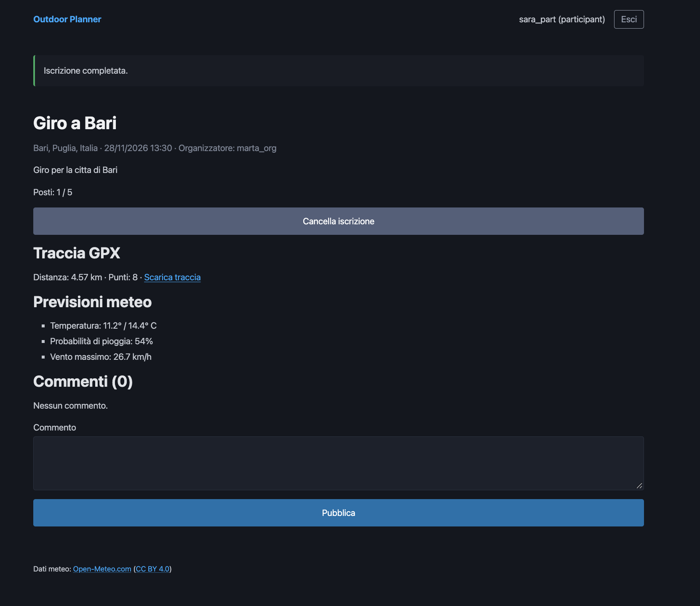

# Outdoor Planner — EGGSolutions-MMQS

Progetto di laboratorio per il corso di **Modelli e Metodi per la Qualità del Software (MMQS)**, A.A. 2026/2027.

## 1. Nome e descrizione

**Outdoor Planner** è un'applicazione web per organizzare uscite all'aperto: escursioni, giri in bici, partite al parco.

**Il problema.** Chi organizza un'uscita di gruppo di solito gestisce iscrizioni, posti disponibili e meteo su strumenti diversi (chat, fogli condivisi, app meteo). Outdoor Planner mette tutto in un'unica pagina: l'organizzatore pubblica l'uscita con luogo, data, posti e traccia del percorso, i partecipanti si iscrivono e commentano, e tutti vedono le previsioni meteo per il giorno e il luogo dell'evento.

**Chi la usa.**
- **Organizzatori**: chi propone e gestisce le uscite.
- **Partecipanti**: chi cerca un'uscita a cui unirsi.

## 2. Gruppo

| Nome e cognome | Matricola | Username GitHub |
|---|---|---|
| Gabriele Contestabile | 827758 | [@GabryWasTaken](https://github.com/GabryWasTaken) |
 
Il gruppo EGG Solutions era composto in origine da tre membri. Gli altri due non frequentano questo corso, quindi il progetto MMQS è sviluppato da un solo membro, come concordato a lezione con il dott. Vito Bavaro.

La proposta progettuale iniziale è in [`idee/gabriele.md`](idee/gabriele.md).

## 3. Dati

L'applicazione usa due API pubbliche di **Open-Meteo**, gratuite per uso non commerciale e senza chiave API:

| Fonte | Link | A cosa serve |
|---|---|---|
| Open-Meteo Forecast API | https://open-meteo.com/en/docs | Previsioni giornaliere: temperatura min/max, probabilità di pioggia, vento massimo |
| Open-Meteo Geocoding API | https://open-meteo.com/en/docs/geocoding-api | Ricerca di un luogo per nome e relative coordinate |

**Licenza.** I dati sono distribuiti sotto licenza [CC BY 4.0](https://creativecommons.org/licenses/by/4.0/). L'attribuzione "Dati meteo: Open-Meteo.com (CC BY 4.0)" è presente nel footer di ogni pagina.

**Come vengono importati nell'applicazione.**
- **Luogo**: nel form dell'uscita l'utente scrive un nome e preme "Cerca luogo". Il server interroga la Geocoding API, mostra i risultati in un menu e salva nel database nome, latitudine e longitudine del luogo scelto. Le coordinate non arrivano mai dal browser.
- **Meteo**: quando si apre il dettaglio di un'uscita, il server chiama la Forecast API per quella data e quelle coordinate. La risposta viene salvata in cache nel database (tabella `WeatherCache`) per 3 ore, così le pagine successive non richiamano l'API. Open-Meteo fornisce previsioni fino a 16 giorni: oltre, l'app mostra "previsioni non ancora disponibili".
- **Tracce GPX**: l'organizzatore può caricare un file GPX del percorso. Il file viene letto in modo sicuro (con `defusedxml`) per calcolare distanza e numero di punti, e salvato su disco con un nome casuale.

**Dati di prova.** Utenti, uscite, iscrizioni e commenti presenti nel database sono **tutti inventati** e vengono creati dal comando di seed. Non ci sono dati personali reali.

## 4. Funzionalità

### Ruoli utente

| Ruolo | Cosa può fare |
|---|---|
| `organizer` | Crea, modifica e cancella **solo le proprie** uscite; carica la traccia GPX; vede l'elenco degli iscritti alle proprie uscite; commenta |
| `participant` | Si iscrive alle uscite future (fino a esaurimento posti), cancella l'iscrizione, commenta |

Il ruolo si sceglie al momento della registrazione. Un organizer non può iscriversi alle uscite.

### Funzionalità

- **Registrazione, login e logout** con password salvate come hash.
- **Uscite (CRUD)**: titolo, descrizione libera, luogo, data e ora, posti massimi, traccia GPX opzionale. Chi prova a modificare o cancellare un'uscita di un altro riceve un errore 403.
- **Ricerca del luogo** tramite la Geocoding API.
- **Previsioni meteo** nella pagina di dettaglio, con cache di 3 ore.
- **Upload della traccia GPX** (solo `.gpx`, massimo 2 MB), con distanza in km, numero di punti e link per scaricarla.
- **Iscrizioni** con controllo dei posti disponibili; niente iscrizioni a uscite già passate.
- **Commenti** con testo libero sotto ogni uscita futura; l'autore può cancellare i propri.
- **Home page** con le prossime uscite e ricerca per titolo o luogo.

### Screenshot

| Home | Form nuova uscita |
|---|---|
|  |  |

| Dettaglio (vista organizer) | Dettaglio (vista participant) |
|---|---|
|  |  |

## 5. Architettura

| Componente | Scelta |
|---|---|
| Linguaggio | Python 3 |
| Framework web | Flask 3.1 (application factory e blueprint) |
| Database | SQLite tramite Flask-SQLAlchemy |
| Autenticazione | Flask-Login, hash delle password con Werkzeug |
| Form e CSRF | Flask-WTF |
| Template | Jinja2 con [Pico.css](https://picocss.com/) da CDN, nessun framework JavaScript |
| API esterne | Open-Meteo Forecast e Geocoding (via `requests`) |
| Parsing GPX | `defusedxml` |
| Test | pytest |

Le versioni esatte delle dipendenze sono in [`requirements.txt`](requirements.txt).

### Struttura delle cartelle

```
outdoor-planner/
├── outdoor_planner/          # package dell'applicazione
│   ├── __init__.py           # create_app(), registrazione blueprint, comando seed
│   ├── config.py             # configurazione letta dalle variabili d'ambiente
│   ├── extensions.py         # db, login manager, CSRF
│   ├── models.py             # User, Outing, Signup, Comment, WeatherCache
│   ├── seed.py               # dati di prova inventati
│   ├── auth/                 # registrazione, login, logout
│   ├── outings/              # uscite, luogo, GPX, iscrizioni, commenti
│   ├── main/                 # home e ricerca
│   ├── services/             # weather.py, geocoding.py, gpx.py
│   ├── templates/            # template Jinja2
│   └── static/               # CSS
├── tests/                    # test pytest (+ fixtures/sample.gpx)
├── samples/sample-hike.gpx   # traccia inventata per provare l'upload
├── docs/screenshots/         # screenshot usati in questo README
├── idee/                     # proposta progettuale
├── AGENTS.md                 # istruzioni per il coding agent
├── requirements.txt
└── .env.example              # variabili d'ambiente, senza valori reali
```

## 6. Come avviarla

### Requisiti

- Python 3.9 o superiore (richiesto da Flask 3.1)
- Git
- Connessione a Internet (per meteo e ricerca dei luoghi)

### Installazione

```bash
git clone https://github.com/EGGSolutions-MMQS/outdoor-planner.git
cd outdoor-planner
python3 -m venv .venv
source .venv/bin/activate          # su Windows: .venv\Scripts\activate
pip install -r requirements.txt
```

### Variabili d'ambiente

Copiare il file di esempio e impostare i valori locali:

```bash
cp .env.example .env
python3 -c "import secrets; print(secrets.token_hex(32))"   # genera una SECRET_KEY
```

| Variabile | Obbligatoria | Default | Descrizione |
|---|---|---|---|
| `SECRET_KEY` | Sì | — | Chiave per firmare sessioni e token CSRF. Senza, l'app non parte |
| `DATABASE_URL` | No | `sqlite:///outdoor_planner.db` | Indirizzo del database |
| `UPLOAD_FOLDER` | No | `uploads` | Cartella in cui salvare le tracce GPX |

Il file `.env` è escluso dal `.gitignore` e non va mai committato.

### Avvio

```bash
flask --app outdoor_planner seed                # crea il database con i dati di prova
flask --app outdoor_planner run --port 5001
```

Poi aprire http://127.0.0.1:5001.

- Per ricreare il database da zero: `flask --app outdoor_planner seed --reset`.
- Su macOS la porta 5000 è spesso occupata da AirPlay: per questo si usa la 5001.

### Utenti di prova (inventati)

Tutti hanno la password **`demo-pass-2026`**.

| Username | Ruolo |
|---|---|
| `marta_org` | organizer |
| `luca_org` | organizer |
| `sara_part` | participant |
| `paolo_part` | participant |
| `giulia_part` | participant |

Il seed crea anche 5 uscite inventate: una con traccia GPX allegata, una già piena (per provare il limite dei posti), una a 25 giorni (per vedere "previsioni non ancora disponibili") e una già passata. Per provare l'upload a mano si può usare `samples/sample-hike.gpx`.

### Test

```bash
pytest
```

La suite contiene 31 test: registrazione e login, permessi (un organizer non può modificare l'uscita di un altro), iscrizioni oltre i posti disponibili, parsing GPX, geocoding, home e ricerca, servizio meteo con chiamate HTTP simulate (cache e limite dei 16 giorni). I test usano un database SQLite in memoria e non chiamano le API reali.

## 7. Sviluppo con i coding agent

### Agent e modelli

| Strumento | Modello | Uso |
|---|---|---|
| **Claude Code** (CLI, nel terminale) | opusplan: Claude Opus in Plan Mode, Claude Sonnet 5.5 (claude-sonnet-5-5) per l'implementazione | Scrittura di tutto il codice dell'MVP e dei test |
| **Claude** (chat su claude.ai) | Claude Opus 5.5 | Scelta dell'idea, revisione del piano, scrittura di `AGENTS.md` e di questo README, controlli prima della consegna |

### Approccio

1. **Plan Mode.** Claude Code ha prima letto `AGENTS.md` e la proposta in `idee/` e ha proposto un piano (struttura, modelli, rotte, ordine di implementazione, domande aperte) senza modificare file. Il piano è stato rivisto e corretto in due giri: niente email nella registrazione, file GPX salvati su disco con download, niente iscrizioni a uscite passate, versioni esatte delle dipendenze, interfaccia in italiano.
2. **Auto mode.** Approvato il piano, l'implementazione è avvenuta in modalità automatica, sul branch `feature/mvp`, con un commit per ogni fase (scheletro, modelli e autenticazione, CRUD, meteo, GPX, iscrizioni, commenti, home, seed, test). Il push è stato fatto a mano.
3. **Verifica.** Test con pytest, controllo che nel repository non ci siano `.env`, database o segreti, controllo che non ci siano soppressioni di avvisi (`NOSONAR`, `noqa`, `nosec`), poi prova manuale nel browser con entrambi i ruoli.

**Un episodio da segnalare.** Durante l'implementazione l'agent ha provato due volte ad aggiungere un commento `# noqa` per zittire un avviso. Il controllo automatico di Claude Code ha bloccato l'operazione e l'agent ha tolto il commento. Nel codice consegnato non ci sono soppressioni.

### AGENTS.md

Il file [`AGENTS.md`](AGENTS.md) è stato **scritto a mano** (senza `/init`) ed è volutamente breve: contiene solo quello che l'agent non può ricavare dal codice.
- **Da sapere**: usare solo Open-Meteo (non Nominatim), il limite dei 16 giorni per le previsioni, la cache del meteo, l'attribuzione obbligatoria, i due ruoli, dati di prova solo inventati.
- **Piani**: piani brevissimi, con le domande aperte in fondo.
- **Divieti**: non committare `.env` né credenziali, nessun segreto nei comandi, verificare su PyPI ogni nuova dipendenza, non sopprimere gli avvisi dei linter o degli analizzatori, niente `push --force`, `reset --hard` o commit diretti su `main`.

### Skill

Non sono state usate skill esterne.

## 8. Lavoro di gruppo

Il gruppo è composto da un solo membro, che ha svolto tutte le attività: idea, configurazione dell'organizzazione e del repository, guida del coding agent, revisione del codice, test manuali e documentazione.

Ogni modifica è arrivata su `main` tramite branch e pull request:

| Pull request | Branch | Contenuto |
|---|---|---|
| #1 | `idea/gabriele` | Proposta progettuale in `idee/gabriele.md` |
| #2 | `docs/readme` | Prima versione del README |
| #3 | `feature/mvp` | `AGENTS.md`, MVP completo, test, screenshot e README definitivo |

## 9. Limiti noti

- **Posti e accessi simultanei**: il controllo dei posti disponibili non è protetto da accessi contemporanei. Due iscrizioni nello stesso istante sull'ultimo posto potrebbero passare entrambe.
- **Modifica del luogo**: modificando un'uscita, se non si preme "Cerca luogo" resta il luogo precedente, anche se si è cambiato il testo del campo.
- **Credenziali di prova nel codice**: la password dei dati di prova (`seed.py`) e la chiave della configurazione dei test (`config.py`) sono scritte in chiaro. Servono solo per lo sviluppo, ma ci aspettiamo che SonarQube e Fortify le segnalino.
- **Meteo**: disponibile solo da oggi a 15 giorni; per le uscite passate non viene mostrato.
- **Fuori dall'MVP**: niente recupero della password, niente ruolo amministratore, niente notifiche, niente paginazione della home, niente mappa del percorso GPX, nessun limite ai tentativi di login.
- **Solo sviluppo locale**: l'app usa il server di sviluppo di Flask e SQLite; non è configurata per la messa in produzione.
